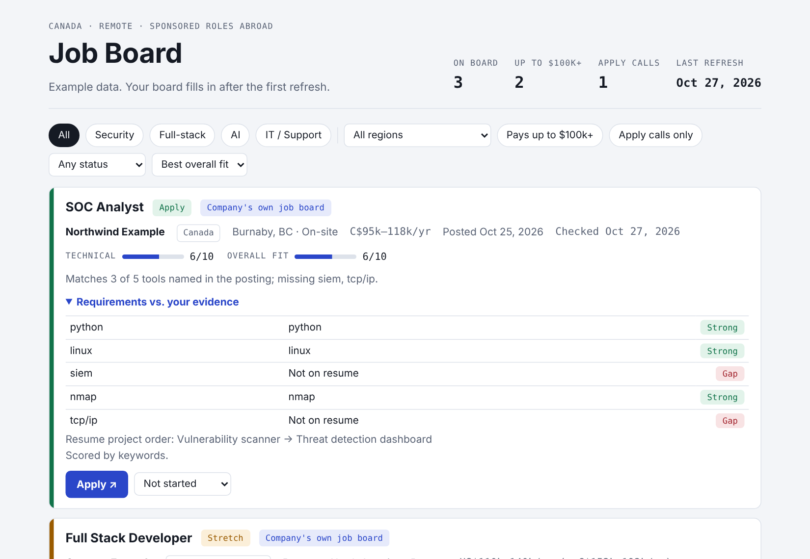

# Job Board

A personal job board that refreshes itself every day. It pulls postings from companies' own job boards and from job sites that publish official feeds, drops anything you can't or shouldn't apply to, scores the rest against your skills and projects, and publishes the result as a website on GitHub Pages.

It runs for free on GitHub Actions. An AI key is optional.



## What it does

Every morning a GitHub Actions workflow:

1. **Fetches postings** from the sources in `config.toml`.
2. **Filters them.** A posting is dropped when:
   - the title isn't a target role, or is senior (senior, staff, lead, manager and so on);
   - it shows scam signs: fees to apply or train, requests to buy equipment, gift cards or crypto, "message us on WhatsApp/Telegram", no named employer, or an apply link that isn't `https`;
   - you couldn't legally take it: it needs citizenship, permanent residence or a security clearance, or it's outside your country without remote-from-your-country or stated visa sponsorship;
   - it asks for 6+ years of experience;
   - the pay tops out below your floor (postings that don't list pay are kept and marked "Salary not posted");
   - it's older than `max_age_days`.
3. **Scores what's left** with a 0–10 technical match and a 0–10 overall fit, makes an Apply / Stretch / Skip call, and lists the posting's requirements next to your evidence. Without an AI key it uses a keyword match. With a key it asks the model, which may only cite evidence from your profile.
4. **Retires closed postings.** If a job disappears from a company's own board, or its link returns 404 or says it's closed, it moves to "Left off the board". Job-board listings are also retired 45 days after they first appear.
5. **Publishes** `docs/` to GitHub Pages.

You track each application's status (Applied, Interview and so on) on the page. Statuses are saved in your browser only.

## Sources

Every source is an official public API or feed that allows automated access.

| Source | What it covers | Verification shown |
|---|---|---|
| Greenhouse, Lever, Ashby job-board APIs | Every open job at the companies you list | Company's own job board |
| Remotive API | Remote jobs | Listed on Remotive |
| Remote OK API | Remote jobs | Listed on Remote OK |
| Himalayas API | Remote jobs | Listed on Himalayas |
| We Work Remotely RSS | Remote jobs | Listed on We Work Remotely |
| Hacker News "Who is hiring?" (Algolia API) | Startups, many remote | Listed on Hacker News |

**LinkedIn, Indeed and Glassdoor aren't included.** Their terms forbid scraping, and they block it. Set up job alerts on those sites yourself. Many of the same jobs also appear on the companies' own Greenhouse, Lever or Ashby boards, which this project reads directly.

Remotive and Remote OK ask that you link back to them. The site credits every posting's source on its card.

### Adding companies

Most tech companies post jobs on Greenhouse, Lever or Ashby. Find the board name in the company's careers URL and add it to `config.toml`:

| Careers URL | Add to |
|---|---|
| `job-boards.greenhouse.io/`**`acme`** | `[sources.greenhouse] boards` |
| `jobs.lever.co/`**`acme`** | `[sources.lever] companies` |
| `jobs.ashbyhq.com/`**`acme`** | `[sources.ashby] boards` |

Use `"slug|Display Name"` to set the company's display name. Then run `python -m jobboard check-sources` to confirm every name resolves.

## Set up on GitHub

You need a GitHub account. Nothing to install.

1. **Create a repository** and upload these files. Don't upload `profile.toml` or `.env`; `.gitignore` already leaves them out.
2. **Add your profile as a secret.** Copy `profile.example.toml` to `profile.toml` on your computer and fill it in. Then in the repository go to **Settings → Secrets and variables → Actions → New repository secret**, name it `PROFILE_TOML`, and paste the whole file.
3. **Turn on Pages.** Go to **Settings → Pages** and set **Source** to **GitHub Actions**.
4. **Run it once.** Go to **Actions → Refresh job board → Run workflow**. When it finishes, your site is at `https://<your-username>.github.io/<repo-name>/`.

From then on it refreshes every day at 13:14 UTC (6:14 a.m. in Vancouver during daylight time). Change the `cron` line in `.github/workflows/refresh.yml` to pick another time.

### Optional: AI scoring

Keyword scoring works without a key. For sharper scores and plain-language explanations, add an AI provider:

| Setting | Where | Example |
|---|---|---|
| `LLM_API_KEY` | **Secrets** tab | your API key |
| `LLM_PROVIDER` | **Variables** tab | `anthropic`, `openai`, `gemini`, `openai-compatible` |
| `LLM_MODEL` | **Variables** tab | a model name from your provider |
| `LLM_BASE_URL` | **Variables** tab | only for `openai-compatible`, e.g. a Groq or OpenRouter URL |

Both tabs are under **Settings → Secrets and variables → Actions**. `anthropic` defaults to a small, inexpensive model if `LLM_MODEL` is empty. `max_new_per_run` in `config.toml` caps how many new postings are scored per run, which keeps costs predictable.

**Keep keys out of the code.** Put them only in GitHub Secrets or in a local `.env` file. Never in `config.toml`, `profile.toml` or anything under `docs/`: everything in `docs/` is published. The key is only sent to the provider you chose, in a request header, and never appears in logs or in the site.

## Privacy

If your repository is public, so is the site, including the "your evidence" column and notes such as your availability.

- To keep your evidence off the site, set `show_evidence = false` under `[site]` in `config.toml`.
- To keep everything private, make the repository private. Pages on a private repository needs GitHub Pro, which is free for students through the [GitHub Student Developer Pack](https://education.github.com/pack). Or skip Pages and run the board on your computer (below).

Your profile is never published: it's read from the `PROFILE_TOML` secret during each run.

## Run it on your computer

Needs Python 3.11 or newer.

```bash
python -m venv .venv
source .venv/bin/activate            # Windows: .venv\Scripts\activate
pip install -r requirements-dev.txt
cp profile.example.toml profile.toml # then fill it in
cp .env.example .env                 # optional: AI key for local runs

python -m jobboard check-sources     # test every source
python -m jobboard refresh --dry-run # see what would be added, write nothing
python -m jobboard refresh           # update docs/data/
python -m jobboard serve             # open http://localhost:8000
python -m pytest -q                  # run the tests
```

`refresh --only greenhouse remotive` limits a run to some sources.

## Configuration

**`config.toml`** (safe to commit) holds settings that aren't personal:

- `[run]`: pay floor and goal in CAD, how old a posting can be, how many new postings to score per run, time zone.
- `[site]`: page title, subtitle, `show_evidence`.
- `[currency_to_cad]`: rough exchange rates used to compare foreign pay. Update them now and then.
- `[titles]`: phrases a title must include, and phrases that rule it out.
- `[scam]`: phrases that drop a posting.
- `[sources.*]`: which sources and companies to read.

**`profile.toml`** (private) holds what's about you:

- `[work_authorization]`: citizenship, permanent residence, where you can work, whether you need sponsorship abroad, whether you can hold a clearance.
- `[location]`: places you'd work on-site, words that mean "your country", and remote locations that include you.
- `skills`: only skills you can back up. They drive the keyword score.
- `evidence`: short, truthful notes on your experience and projects. The AI scorer may cite only these.
- `[project_order]`: which projects to lead with on your resume for each kind of role.

## Project layout

```
config.toml              settings (committed)
profile.example.toml     template for your private profile.toml
jobboard/
  sources.py             one fetcher + normalizer per source
  filters.py             title, scam, work-authorization, location, experience and pay rules
  salary.py              finds pay in postings and converts it to annual CAD
  scoring.py             keyword scorer and AI scorer
  llm.py                 minimal client for several AI providers (no SDKs)
  refresh.py             runs a refresh end to end
  store.py               reads and writes docs/data/*.json
  __main__.py            command line
docs/                    the website (published to GitHub Pages)
  index.html, app.js, styles.css
  data/jobs.json         postings on the board (written by refresh)
  data/meta.json         last run: sources, closed postings, skip reasons
tests/                   pytest suite with sample payloads for every source
.github/workflows/       daily refresh + publish, tests, manual publish
```

## Troubleshooting

- **A source shows "failed".** Run `python -m jobboard check-sources`. A 404 means the board name in `config.toml` is wrong or the company moved to another job system. Other failures are usually temporary.
- **The board is empty after a run.** Open the run's log on the Actions tab: the "Skipped" list shows why postings were dropped. Loosen `[titles]`, `max_age_days` or the pay floor if it's too strict.
- **"No profile found".** The `PROFILE_TOML` secret is missing or empty.
- **The daily run stopped.** GitHub pauses scheduled workflows in repositories with no activity for 60 days. Re-enable it on the Actions tab.

## Limits

- The filters read the words in each posting. A posting that hides its requirements, pay or location can slip through or get dropped. Read the full posting before you apply.
- Exchange rates are approximate.
- Nothing here is legal or immigration advice. Check work-permit questions with official government sources.

## License

MIT. See [LICENSE](LICENSE).
