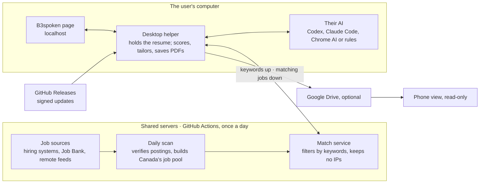

# B3spoken (work in progress)

> B3spoken is built and released from the `main` branch. Old Job Hunt Kit installs move to B3spoken by themselves when they update (kit 3.0.0). B3spoken is a placeholder name.

B3spoken is a free, open-source job search tool. It finds verified jobs every day, matches them to each person's resume and writes them tailored resumes and cover letters using the AI they already pay for. It is a ground-up rebuild of the Job Hunt Kit with no career-ops code in its architecture.

What's built so far is in [`b3spoken/`](b3spoken/); see [Build status](#build-status).

## Install B3spoken (testers)

Get it from the [latest release](https://github.com/Dapper-D/job-board/releases/latest) (from 0.1.12 on, B3spoken releases are marked Latest; earlier ones are under the [B3spoken releases](https://github.com/Dapper-D/job-board/releases?q=b3spoken&expanded=true)).

- **Installer:** Windows `B3spoken-Setup-<version>.exe`, Mac `B3spoken-mac-…zip`, Linux `B3spoken-linux-…tar.gz`.
- **From source, so you can read every file first:** download `B3spoken-source-<version>.tar.gz` (or this branch's code zip) and unpack it. On Windows, **double-click `setup.cmd`**; it unblocks the downloaded files and runs `setup.ps1` without changing any PowerShell settings. On Mac and Linux, run `bash setup.sh`. Setup only checks for Node.js 22, adds a B3spoken shortcut and starts the app. B3spoken has no other packages: everything it runs is in that folder. `uninstall.cmd` (Windows) or `uninstall.sh` removes it again.

Both kinds update themselves with the **Update now** button, and only with releases signed by the maintainer's key. Your own files (resume, answers, tracker, documents) are kept in `%LOCALAPPDATA%\B3spoken` on Windows, `~/Library/Application Support/B3spoken` on Mac and `~/.local/share/b3spoken` on Linux, and survive updates.

The `app/` folder on this branch is the old Job Hunt Kit's code, kept for reference; B3spoken doesn't use it.

## Decisions already made

| Area | Decision |
| --- | --- |
| Shape | A desktop helper that everyone installs; after setup it opens B3spoken on their own computer at localhost. A simple free download page (GitHub Pages) is the only public site |
| Accounts | None by default; data stays on the person's computer |
| Optional sign-in | Google, to sync to their own Google Drive and get a view-only phone view |
| Computers | Windows, Mac and Linux; only the Windows installer is signed at first |
| AI | ChatGPT (Codex) and Claude (Claude Code) both fully supported; Chrome built-in AI as the free fallback; rule-based tailoring for people with neither |
| Daily scan | Runs once on shared servers (GitHub Actions in the public repo), not on each computer |
| Privacy | The helper sends only derived keywords, never the resume |
| Launch country | Canada |
| Fields | All fields, personalised from each resume and the onboarding questions |
| Job sources | Employer hiring systems, government job banks, remote feeds and pasted links; no scraping of LinkedIn, Indeed or Glassdoor |
| Price | Free for now, with room for a monthly subscription later |
| Code | Public; anonymous usage counts only |
| Hosting | No paid hosting yet; Vercel's free plan at most |
| Testing | On this branch, with a small group of friends (mostly Windows) |
| Old kit | Keeps working; automatic migration only after a lot of testing |

## How it works, from download to daily use

A new user is set up in about 15 minutes, then gets a fresh list of matched jobs with ready-made documents every morning.

1. **Download.** From the download page (GitHub Releases at first). Windows gets a signed installer; Mac and Linux show the usual "unidentified developer" warning with steps to allow it.
2. **Install.** One installer, no terminal. It sets up the helper, adds a B3spoken shortcut and starts it in the background.
3. **Open B3spoken.** Setup ends by opening B3spoken in their browser at a localhost address, served by the helper on their own computer. The shortcut opens it again any time; nothing is hosted online.
4. **Connect an AI.**
   - ChatGPT: the helper installs Codex and opens the ChatGPT sign-in.
   - Claude: the helper installs Claude Code and opens the Claude sign-in.
   - Neither: Chrome's built-in AI if their computer can run it, otherwise rule-based tailoring with no AI.
5. **Upload a resume.** The AI builds a resume library: every job, project and bullet, each with an ID. Lines it isn't sure about are flagged and never used until the user checks them.
6. **Answer the questions.** Target roles (with a check if a target is far from the resume), pay floor and goal, on-site and remote locations, work authorization, start date, skills they don't have and industries to avoid.
7. **Pick extra roles.** B3spoken suggests related and niche roles, each with a one-line reason; each is a toggle.
8. **Optional: sign in with Google.** Saves copies to their own Google Drive and turns on a view-only phone view.
9. **Every morning.** The shared scan has already collected Canada's new postings. The helper sends only keywords, gets back the matching jobs, then on their computer verifies each posting, scores it and writes a tailored resume and cover letter as PDFs.
10. **Use the board.** New jobs, scores and reasons, the PDFs and an Apply link straight to the employer's own posting. Track status, add notes and paste any job link to have it checked and tailored.
11. **Updates.** The helper installs new signed versions by itself; a bad or unsigned update is refused.

## Architecture

The heavy daily scan runs once for everyone on free GitHub servers; everything personal runs on each user's own computer.



## AI

The AI always runs on the user's own computer, signed in with their own account, so B3spoken never holds anyone's AI login or pays for their usage.

| AI | How they connect | Who it's for | Rules and limits |
| --- | --- | --- | --- |
| ChatGPT | The helper installs Codex; they sign in with ChatGPT | Plus, Pro or Business plans | OpenAI allows open-source, local apps to use plan usage; a hosted website would need OpenAI's approval |
| Claude | The helper installs Claude Code; they sign in with Claude | Pro or Max plans | Claude Code itself is Anthropic's own tool; B3spoken runs it as-is, the way career-ops does. Using consumer sign-ins inside third-party apps is restricted, so this is documented for users as a grey area |
| Chrome built-in AI | Nothing to sign in to | Anyone with a strong enough computer, including Gemini users | Desktop Chrome only; more than 4 GB graphics memory or 16 GB RAM; about 22 GB free disk; short inputs; works only while the page is open |
| No AI | Nothing | Everyone else | Rule-based tailoring: picks and orders their own bullets by keyword match |

How the AI is locked down: Codex runs read-only and ignores the user's own config; Claude Code runs with no tools, no MCP servers and no slash commands; the AI only picks bullet IDs from the resume library and never writes claims of its own.

## Onboarding and role matching

The resume decides what B3spoken searches for; the user's answers can widen or redirect it but never add claims.

1. Upload the resume (PDF or Word). The AI builds the library and lists the roles the resume supports.
2. The user types the roles they want.
3. If a target is drastically different from what the resume supports, B3spoken says so and asks: use the suggested roles, or keep theirs (then it expands from their role).
4. Pay floor and goal, locations, work authorization, start date, skills they don't have, industries to avoid.
5. Related and niche roles, each with a one-line reason, each a toggle.
6. The profile becomes the search keywords sent to the daily scan. The resume stays on their computer.

## Features carried over from the kit

| Feature | What it does |
| --- | --- |
| Verified jobs only | Each posting is checked on the employer's own careers site or hiring system; anything unverifiable is left off |
| Scam and trap checks | Flags fake postings, payment requests and hidden instructions aimed at AI tools |
| Scoring | Fit score with reasons; jobs scored Skip never appear |
| Pay and location filters | The user's floor and goal, on-site area and remote rule |
| Freshness | Pasted links must be posted within the last 72 hours |
| Tailored resume | One-page PDF, real bullets, ATS-safe, no AI metadata, job title in the summary, bullets reordered to show transferable skills |
| Cover letter | PDF, honest about gaps, never claims missing skills |
| Tracker | Status, notes, follow-up reminders and interview prep per job |
| Paste a link | Matches it to the employer's own posting, then verifies and tailors it |
| Health check | Plain PASS/WARN/FAIL list with a fix for each problem |
| Signed updates | Checked against the release key before anything is installed |

**New after the core build: recruiter contacts for cold emails**

- Pull recruiter or HR emails already published in the posting or on the employer's own careers, contact or team pages.
- Optional Hunter.io lookup with the user's own free key, showing its confidence for each address.
- Draft a short cold email from the tailored resume; the user reviews it and sends it from their own email. Nothing is sent automatically.
- Never scrape LinkedIn and never guess-and-test addresses against mail servers. Only published business emails, used for that one job.

## Privacy and security

No resume, AI login or personal document leaves the user's computer unless they turn on Google Drive sync, and then it goes only to their own Drive.

| Data | Goes to | Kept for |
| --- | --- | --- |
| Search keywords (titles, skills, locations) | B3spoken match service | Deleted right after the match; no IP addresses stored |
| Anonymous usage counts | B3spoken | Totals only, no IDs |
| Copies of PDFs and the tracker (opt-in) | The user's own Google Drive | As long as they keep them |
| AI prompts | Their own ChatGPT or Claude account | Under that vendor's terms |

- The helper listens only on the user's own computer, with a secret token, session cookie, Host check and CSRF header.
- Job pages are fetched over HTTPS only, to hosts each source declares, with private network addresses blocked.
- Releases are signed with Ed25519 and checked before unpacking.
- Admins sign in with Google plus two-factor; no shared master password; one logged, deletable break-glass login.
- The release signing key lives only in GitHub's protected `release` environment and the owner's password manager. A maintainer approves each release.

## Code ownership, credits and job sources

B3spoken's architecture and main code are written from scratch; career-ops is not installed, pinned or run.

| Part | Where the code comes from |
| --- | --- |
| Helper, board, tailoring, PDFs, updater | Our own |
| Greenhouse, Lever, Ashby, Workday, SmartRecruiters, Workable scanners | Our own, using each system's public job feed |
| Job Bank Canada (and USAJOBS later) | Our own, using their public data |
| Niche hiring systems | Copied from career-ops under its MIT licence, with its notice kept in `NOTICES.md` |
| Employer list | A large starter list plus automatic discovery |

- Credit for career-ops goes in `NOTICES.md` only. Its name is never used in our product name, domain, screens or "Powered by" lines.
- LinkedIn, Indeed and Glassdoor are never scraped; a pasted link from them is matched to the employer's own posting.

**Getting the most jobs legally**

- Use every source that publishes a public job feed or allows automated access.
- Before a source is added, check its terms of use and robots rules, and record the result in `SOURCES.md`.
- Track as many Canadian employers as possible: a large starter list plus automatic discovery.
- Cross-check every job against the employer's own careers site; anything that can't be confirmed is dropped.

## Hosting, cost and a future subscription

| Piece | Where it runs | Cost |
| --- | --- | --- |
| Daily scan and job pool | GitHub Actions in the public repo | Free |
| Match service | A GitHub-hosted job list the helper filters locally at first; a small Vercel function later if needed | Free |
| B3spoken page | Served by the helper at localhost; a static GitHub Pages download page | Free |
| Downloads and updates | GitHub Releases | Free |
| AI | The user's own ChatGPT or Claude plan | Paid by the user |
| Sync | The user's own Google Drive | Free for them |

A future subscription charges for the service, not the app: the shared scan and matching run on our side. What is free and what is paid will be decided later.

## Testing, branch, release and migration

1. Build in small pieces on this branch, each with tests on Windows, Mac and Linux.
2. A small group of friends installs pre-release builds; both ChatGPT and Claude users test every step.
3. Pre-releases (for example `b3spoken-0.1.0`) are signed like the kit and approved by a maintainer.
4. Merge to `main` only when it's stable.
5. Migrate the old kit last, automatically, after a lot of testing.

## Build status

| Piece | Status |
| --- | --- |
| Safe HTTP client (HTTPS only, per-source host list, private addresses blocked, polite delays, retries) | Done, tested |
| Scanners for 21 hiring systems: Greenhouse, Lever, Ashby, Workday, SmartRecruiters, Workable, BambooHR, Breezy, Pinpoint, Teamtailor, Oracle Recruiting Cloud, Phenom, Eightfold, iCIMS (Jibe), Rippling, SAP SuccessFactors, Taleo, Jobvite, plus Amazon, Google and Apple's own sites | Done, tested; live check in GitHub Actions |
| Job sites: Remotive, Remote OK, Jobicy, Himalayas (terms in [`b3spoken/SOURCES.md`](b3spoken/SOURCES.md)) | Done; their jobs are kept only when found on the employer's own board |
| Job Bank Canada (runs on each person's computer, last 3 days) | Done; to be tested on a home connection |
| Canada filter; duplicates merged so each job is shown and counted once | Done, tested |
| Employer discovery (careers-page links, page markers, pages read in a headless browser, robots.txt respected, confirmed name guesses) | Done: about 310 employers and job sites in the scan; last live check found 11,503 unique jobs in Canada |
| Daily shared scan publishing the job pool ([job-pool release](https://github.com/Dapper-D/job-board/releases/tag/job-pool)) | Done; runs every morning from `main` |
| Not covered: Dayforce (behind a bot check), Meta (no public feed), Taleo Business Edition, older iCIMS sites, classic hosted sapsf.com sites | Left out on purpose or for later |
| Helper (step 3): opens the board at http://127.0.0.1, downloads the daily pool and checks its size and SHA-256 before using it, runs Job Bank on the person's computer (last 3 days, at most every 6 hours), merges duplicates, finds ChatGPT (Codex) or Claude (Claude Code) | Done, tested on Windows, Mac and Linux, with a smoke test against the real pool; asking the AI is wired but not yet tried with real accounts |
| Onboarding (step 4): pick an AI; upload a resume (PDF, Word or pasted text, read on the person's computer with no outside libraries); resume library with an ID for every line; optional AI pass where anything not in the resume word for word is flagged until the person checks it; roles the resume supports, a warning for far targets, related and niche roles as toggles; pay floor and goal (each per hour or per year), province, cities, remote, work authorization, start date, missing skills, industries to avoid | Done, tested; tried end to end in a browser with a real Claude Code pass |
| Matching and tailoring (step 5): every job scored 0-100 with plain reasons (skills you have and don't, title vs your roles, years asked for, seniority, pay vs your floor and goal); hard stops (pay below your floor, no sponsorship when you need it, citizenship or clearance, industries to avoid) make a job Skip and Skip jobs never show. One-click tailored resume and cover letter as one-page PDFs: only your own lines, closest to the job first (your AI can pick the order), the role sought only as "Seeking a ___ role.", embedded Carlito font (Calibri widths), PDF details limited to the title and your name; the letter quotes your real work and says plainly which asked-for skills you haven't used yet | Done, tested; scored the real pool of 10,348 jobs in about 4 seconds |
| The board (step 6): Matches, Tracked and Follow-ups views; status, notes and a follow-up date per job (applying sets a reminder a week later); jobs marked Not interested disappear; documents already made show on each job; paste a link from an employer's own hiring site and it's checked against that employer's live job list (closed or older-than-72-hours postings are refused; LinkedIn, Indeed and Glassdoor links are never fetched) | Done, tested |
| Windows installer (step 7): one B3spoken.exe (Node single executable with the board and catalog inside), a per-user installer with no admin rights, Start menu and optional desktop shortcuts; opening it again just reopens the board | Done: built, installed, tested and uninstalled on a clean Windows machine in GitHub Actions on every push |
| Pre-release for friends | Ready: pushing a `b3spoken-v0.1.0` tag builds and tests it, then waits for the maintainer's approval before signing and publishing |
| Interview prep per job: questions from the posting (openers, skills they asked for, skills you don't have yet with an honest way to answer, situations the posting hints at, and up to 5 role-specific questions from your AI), each with the lines from your own resume that answer it, plus questions to ask them | Done, tested; tried in a browser with a real Claude Code pass |
| One-click AI setup: Install it for me (each company's official installer, no admin rights), Sign in (opens the tool's own sign-in), Check it works | Done; both installers tested on a clean Windows machine in GitHub Actions; sign-in needs a person |
| Documents ready in advance: after each refresh, a resume and cover letter for every Strong and Good match from the last 3 days (your AI picks the order for the best 12); the board shows progress | Done, tested |
| Updates: the board offers newer versions; the update is downloaded, checked against the release key and its SHA-256, installed silently and B3spoken reopens; your setup, tracker and documents are kept | Done, tested; checked against the real releases on GitHub |
| Recruiter contacts per job: emails published in the posting or on the employer's own pages (robots.txt respected, same domain only), plus Hunter.io with the person's own key (recruiting and HR people only); never LinkedIn, guessing or mail-server checks. A draft email from their own lines, which they copy or open in their own email app; nothing is sent | Done, tested |
| Import from the Job Hunt Kit: setup finds the kit folder (Desktop, Documents, home) and brings over the resume library (with its check flags), answers, AI choice and tracked jobs; the kit folder is only read | Done, tested |
| Mac and Linux: one-file apps (Mac zip for Apple silicon, Linux tar.gz) built and tested on every push, included and signed in each release | Done; Mac app isn't notarized yet (needs a paid Apple developer account), so Mac asks once before opening it |
| Later: Google Drive sync and phone view, code-signing the .exe | Not started |

Run it yourself (Node 22 or newer):

```
cd b3spoken
npm test            # offline tests
npm run live-check  # calls every source for real
npm run scan        # writes out/pool.json and out/report.json
npm run helper      # starts the helper and opens the board in your browser
```

## Open questions

- Final product name and domain
- Verify the Gemini CLI personal sign-in shutdown with Google's own announcement
- Which friends test first, and on which computers
- Mac code-signing later (needs a paid Apple developer account)
- What a future subscription includes and costs
